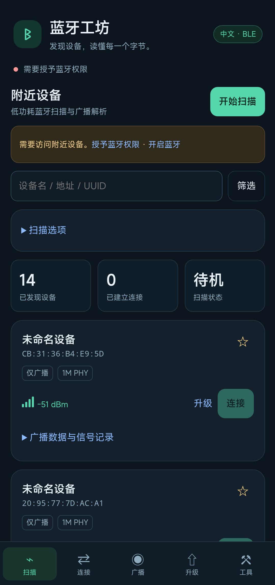

# 蓝牙工坊 / BLE Workshop

面向 Android 的中文低功耗蓝牙（BLE）调试工具。当前版本 **0.1.2**，采用 **Rust 数据核心 + Java Android 原生蓝牙桥接 + HTML/CSS/JavaScript 本地 WebView 界面**。

适合查看附近 BLE 广播、调试自有外设 GATT 服务、搭建简单广播与服务端，以及为兼容设备准备 Nordic DFU。操作入口已实现不代表所有外设均已完成实机兼容性验证，请结合下方验证范围使用。

- [下载安装包](https://github.com/shuizhaodemumu/ble-workshop/releases/latest)
- [作者主页](https://shuizhaodemumu.github.io/)
- 开源协议：MIT；第三方组件按其各自许可证分发。



## 运行条件与安装

1. 使用 Android 8.0 / API 26 及以上、**arm64-v8a** 的手机；当前没有 32 位 ARM、x86、iOS 或桌面安装包。目标 SDK 为 35，最低系统版本仅表示安装门槛，不代表全部版本已实测。
2. 从 Releases 下载 `ble-workshop-0.1.2-arm64.apk`，按手机提示允许浏览器或文件管理器安装应用。包名为 `com.codex.bleworkshop`，可与 nRF Connect 并存。
3. 开启蓝牙，首次启动按系统提示授予附近设备和定位权限；DFU 通知需通知权限。权限被永久拒绝时，在系统设置 → 应用 → 蓝牙工坊 → 权限中手动开启。旧系统或部分厂商机型还需要打开系统定位服务。
4. 更新同包名应用须使用相同签名。自行构建产生的新签名不能覆盖作者签名的安装包；卸载会丢失应用本地设置，先导出所需数据。

正式交付包关闭 Android `debuggable` 与 WebView 调试；本版本没有声明互联网权限，页面与数据解析在本机执行。导出的日志可能含设备地址和通信内容，分享前自行检查。

## 功能与边界

| 模块 | 当前代码已实现 | 使用条件与限制 |
| --- | --- | --- |
| 扫描 | 扫描模式/时长、服务 UUID 硬件筛选；名称、地址、UUID、RSSI 和可连接性本地筛选；收藏、广播解析、RSSI 采样及 CSV 导出 | BLE 广播，不提供经典蓝牙音频、文件传输或串口终端；地址可能随机化；不承诺发现全部附近设备 |
| GATT 客户端 | 多设备会话、直接/自动连接、系统配对、服务/特征/描述符发现、读取、带响应/无响应写入、通知/指示、MTU、RSSI、连接优先级 | 目标必须可连接且支持相应属性；配对、加密、MTU 和连接参数最终由系统与外设决定；无长期后台保活 |
| 广播与 GATT 服务端 | 自定义主要服务与特征 UUID、初始值、厂商数据；客户端读写、CCCD 订阅、向订阅者通知 | 依赖手机支持 BLE 外设广播；当前仅一个主要服务与一个读/写/通知特征，不支持预备写入、多特征编辑器 |
| Nordic DFU | 官方 DFU 2.11.0、Legacy/Secure、ZIP 或 BIN/HEX + Init DAT、SHA-256、确认、进度、暂停/继续/停止 | 面向兼容 nRF5 SDK 引导程序的 nRF51/nRF52；不是通用刷机工具，不支持 nRF Connect SDK / MCUboot；真实刷写尚未验收 |
| 数据工具 | 十六进制/UTF-8、CRC32、UUID 标准化、广播解析，电池/温度/湿度/心率等常见特征解码，自定义 UUID 名称 | 仅常用中文 UUID 条目与部分语义解码，不是完整 Bluetooth SIG 数据库；专有协议需要自行解释 |
| 自动化与日志 | JSON 脚本、导入/导出、中文日志 | 脚本最多 100 步，单次 wait 为 0–60000 ms；不兼容 nRF Connect XML；日志最近 4000 条 |

RSSI 保留最近 300 个采样，扫描中每 3 秒批量刷新真实收到的数据，没有新广播时保留上次值；没有图形曲线，也不提供可靠测距。离开应用时扫描停止；DFU 使用前台服务，普通连接不保证后台持续运行。

## 如何使用

### 1. 扫描并查看广播

进入扫描页，选择扫描模式、时长和可选服务 UUID，点击开始扫描。找不到设备时先清空筛选，将外设置于广播状态并靠近手机。点击设备的“广播数据与信号记录”，查看原始广播、解析字段和信号采样；按需收藏或导出 CSV。扫描中的详情弹窗会同步更新。

### 2. 连接、读写与订阅

选择可连接设备并连接，在连接页切换目标会话，等待服务发现。展开服务和特征，依据属性读取、写入或开启通知/指示。写入使用合法十六进制字节，例如 `01 02 FF`；文本可先在工具页转成 UTF-8 十六进制。无响应写入不等于外设已确认业务成功。

需要配对时调用系统配对；MTU、RSSI 与连接优先级入口用于向系统发起请求，观察日志确认结果。结束时关闭订阅并断开连接。不要根据特征中文名称猜测专有设备的写入协议。

### 3. 广播与服务端

在广播/服务端页填入服务 UUID、特征 UUID、初始值与厂商数据，启动广播及服务端。使用另一台 BLE 客户端扫描和连接该手机，读写特征或订阅通知；修改服务端值后向订阅者发送通知。实际跨设备交换尚待验证。广播长度超过硬件限制、蓝牙关闭或手机不支持外设模式时，查看中文日志和系统返回错误。

### 4. DFU 固件升级

先确认芯片、引导程序类型、应用版本和固件来源匹配，再选择目标与 ZIP 或 BIN/HEX（必要时附 Init DAT）。核对文件信息和 SHA-256；文件哈希仅用于核对内容，不会自动证明固件适配或来源可信。选择文件只是准备，必须通过系统确认框才开始升级。保持设备供电和近距离连接，使用界面暂停、继续或停止。真实固件刷写尚未验证，不把界面显示成功准备当作升级验收。

### 5. 工具、脚本与导出

工具页可做格式转换、UUID 与广播解析，导入/导出自定义 UUID 字典（`{"180f":"电池服务"}`），或导出中文日志。文件由 Android 文件选择器读写。

连接并选定设备后，可执行以下只请求 MTU 和 RSSI 的 JSON 脚本：

```json
[
  {"action":"mtu","value":247},
  {"action":"wait","ms":1000},
  {"action":"rssi"}
]
```

支持 `read`、`write`、`notify`、`mtu`、`rssi`、`wait`。特征操作的 `key` 必须通过特征“复制标识”取得，不是单独的 UUID；执行写入脚本前会确认。步骤按 GATT 队列等待回调，失败、断连或超时会停止；可手动停止脚本。

## 技术架构与源码

```text
本地 HTML / CSS / JavaScript 界面
       ↕ WebView JavaScript 桥接
Java MainActivity / Android Bluetooth API ── Nordic Android DFU
       ↕ JNI Core.call
Rust ble-core：字节校验、CRC32、UUID、广播与常见特征解析
```

| 路径 | 内容 |
| --- | --- |
| `core/src/lib.rs`、`core/Cargo.lock` | Rust 核心与锁定依赖；Rust 2021、jni 0.21.1、serde_json |
| `app/src/com/codex/bleworkshop/` | Java Activity、JNI 门面、DFU 前台服务 |
| `app/assets/index.html` | 自包含中文界面与交互脚本 |
| `app/AndroidManifest.xml`、`app/res/` | 权限、服务、名称与图标资源 |
| `build-core.ps1`、`build-apk.py` | 现有 Windows Rust 编译与 APK 资源/Java/D8/签名打包脚本 |
| `tool-bootstrap/` | 固定版本清单与依赖获取辅助脚本 |
| `test-*` | 既有 JNI、模拟桥接 UI、连接手机检查入口；不是完整兼容性测试套件 |
| `third-party-licenses/`、`THIRD_PARTY_NOTICES.md` | 第三方许可证与声明 |

业务源码以 Rust、Java 和 JavaScript 编写，CSS/HTML 实现界面；Python、PowerShell 用于构建与打包。Kotlin 标准库是 DFU 的传递依赖，本项目没有 Kotlin 业务源码。不是纯 Rust Android 应用，也不是 Gradle/Android Studio 一键工程。

## 从源码构建

**现有脚本依赖原开发机目录，需要先适配路径；全新电脑一键构建尚未验证。** 仓库不含 JDK/SDK/NDK、Cargo 缓存、构建产物和作者签名私钥。

需要 Windows、Python 3、JDK 17（原环境 17.0.20.1+1）、Rust 工具链与 `aarch64-linux-android` 标准库、Android API 35 平台、build-tools（脚本目录名 `android-15`）、NDK r27c 与 API 26 arm64 链接库、R8/D8 8.13.19。第三方版本见 `tool-bootstrap/versions.json`，含 Nordic DFU 2.11.0。

原脚本的目录约定（`workspace` 是构建工作区，仓库放 `work/android-source`）：

```text
workspace/
  work/android-source/       # 本仓库
  work/android-tools/        # jdk/、build/、platform/、ndk/、deps/、native-libs/、r8-8.13.19.jar
  work/android-signing/      # 仅本机，自行生成签名，禁止提交
  outputs/                  # 签名 APK
```

1. 按上述布局克隆，准备工具链；`tool-bootstrap` 是原环境辅助脚本，并非完整自动安装器。`remote_extract.py`、`dependencies.py` 等使用原环境本地代理，需按实际网络修改。
2. 修改 `build-core.ps1` 中 Rust 工具链目录、代理与 V:/X: 临时盘符映射；它会检查映射目标，只清理由自身创建的映射。配置 Android 目标及链接库路径。
3. 修改 `build-apk.py` 中工具链版本/目录和签名配置。公开仓库的打包脚本要求通过环境变量 `BLE_KEYSTORE_PASSWORD` 提供自有签名口令，不内置作者口令；请使用独立私钥并妥善备份，禁止提交私钥。此环境变量改动只进行了静态检查，没有重新构建 APK。
4. 在源码目录执行：

```powershell
powershell -ExecutionPolicy Bypass -File .uild-core.ps1 -Mode android
python .uild-apk.py
```

输出位于 `workspace/outputs/蓝牙工坊_中文版_Rust核心_0.1.2_arm64.apk`，构建脚本执行 APK 签名校验及 16KB 对齐校验。`--debug` 会生成可调试包，仅用于本地开发，不应当作正式发行包。不要期待克隆仓库后原脚本在任意目录直接成功。

## 验证状态与已知限制

下面是随项目保存的历史记录，并非本次发布重新测试结果：

- 早期完成 Rust 10 项测试、Windows JVM→Rust JNI 6 项检查、模拟桥接手机尺寸 UI 检查、Android 16 真机 JNI 6 项检查；真机扫描 6.5 秒记录 14 个结果，执行过广播启停与服务端值提交。
- 真实外设 GATT 连接/读写/通知、服务端跨设备交换、真正 DFU 刷写、其他系统和手机尚未验证。
- 后续权限刷新、扫描节流、DFU 生命周期与 0.1.1 交互改动只完成构建/签名/安装，未继续运行测试；0.1.2 修复桌面名称乱码并核对 APK 名称资源。
- 按项目此前“先不进行测试”的要求暂停后续功能与 Gemini 测试；开源发布不改变此验证边界。

本项目借鉴 nRF Connect 的调试工作流程独立实现，不是其官方版本、汉化补丁或恢复源码；不隶属 Nordic Semiconductor，不声称与原软件全部功能或私有行为等价。Nordic DFU 使用官方依赖，没有自行重写 DFU 协议。

## 常见问题

- **扫描为空**：开启蓝牙/定位和权限，清空筛选，确认外设正在广播；退出再回到应用需重新开始扫描。
- **能扫描但无法连接**：可能是不可连接广播、设备被其他客户端占用、地址变化、配对限制或信号弱。查看日志，不能将扫描成功等同连接可用。
- **读写失败/没有通知**：检查特征属性、协议数据、加密/配对和 CCCD；部分设备需先写入握手命令，应用不会自动推断。
- **广播启动失败**：确认手机支持外设模式，缩短广播内容，查看系统错误码。
- **APK 无法覆盖安装**：核对包名、版本、ABI 与签名；自行签名与作者签名不同。
- **浏览器打开页面无法调蓝牙**：HTML 只提供界面；真实蓝牙与 Rust JNI 需要安装 APK，不使用 Web Bluetooth。

## 反馈与贡献

欢迎通过 Issues 报告手机型号、Android 版本、应用版本、复现步骤、预期/实际结果及脱敏日志。外设兼容性与 DFU 问题请补充设备和引导程序型号。提交前排除签名私钥、固件私密内容及个人设备日志。

MIT 许可范围见 [LICENSE](LICENSE)，依赖许可见 [THIRD_PARTY_NOTICES.md](THIRD_PARTY_NOTICES.md)。
